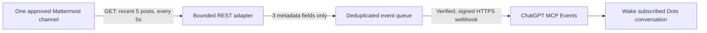

# Mattermost → OpenAI Dots: bounded notification PoC

[日本語](README.ja.md) · [Architecture](docs/architecture.md) · [Setup](docs/setup.md)

An experimental add-on toward using **OpenAI Dots with Mattermost**, beginning with new-message notification. One approved Mattermost channel is read every five seconds; new-post **metadata** is delivered through MCP Events to wake the subscribed ChatGPT conversation. This is an early notification step, not a complete chat integration.

**No automatic replies, Mattermost writes, always-on operation, or two-way conversation are implemented.** REST polling is used at the source; this is not native Mattermost push. Message bodies may enter transient HTTP-response memory, but only `channel_id`, `post_id`, and `created_ms` reach the event queue and callback.



## What was observed

The owner reported one finite live trial on **October 8, 2026** using the private supervised implementation: **1 new post → 1 delivered event → matching ChatGPT conversation wake**, **55 REST reads**, and **zero active subscriptions after expiry**, with transient signing material cleared. The private implementation's offline test run reported **49 PASS**.

Those are historical observations, **not a fresh live test of this public export**. Raw logs, callback addresses, keys, actual IDs, local paths and private history are intentionally not published. The public runtime template replaces the original machine-specific supervisor. Public-export test results are recorded separately in [verification](docs/verification.md).

## Try the safe offline path first

Python **3.11+**, standard library only; no dependency installation:

```sh
python -B -m unittest discover -s tests -v
python demo.py
```

The demo uses synthetic identifiers, a fake clock, a temporary database and a callback fixture under `.invalid`. It performs **no HTTP request, Mattermost read, ChatGPT connection or posting**. Windows-only DPAPI/lifecycle checks are skipped on other operating systems; core signing/scope/polling tests still run there.

The opt-in live template is **Windows-only** because it uses DPAPI for callback URL/signing-secret storage. See [setup](docs/setup.md); real integration additionally needs an authorized MCP tunnel/host and a ChatGPT workspace supporting MCP Events. This repository does not include a tunnel client, workspace credentials, installed plugin or public hosting configuration. Offline success does not demonstrate a live ChatGPT wake.

## Bounds and limitations

- One channel; one subscription; at most **5 minutes**, **60 source reads**, **5 unique events**, and **3 delivery attempts per event**.
- Discovery starts no polling. Monitoring begins only after subscription and callback verification.
- Requested TTL cannot extend the finite grant. Expiry, successful active unsubscribe, EOF and shutdown stop monitoring and clear callback/signing values.
- A full page of new source posts is treated as a possible gap and stops the source. No history expansion or gap-free replay claim.
- No sustained-operation, restart-resilience, complete-history, delivery-SLO, demand or production-readiness claim.
- A dedicated least-privilege Mattermost token is required for live use. A channel filter constrains this code; it does not reduce a broadly privileged token's server-side rights.
- The public template supplies local bounds, not the private deployment's owner/SID/hash supervisor. It uses environment credentials in its owner process and must not be exposed as an unauthenticated remote endpoint. Callback state is protected on Windows, but same-user/admin code is not absolutely isolated.

## Relation to the official Mattermost MCP server

Mattermost already provides read/search/post/channel tools in its [official Agents MCP server](https://docs.mattermost.com/administration-guide/configure/agents-admin-guide#mattermost-mcp-server). This PoC explores a complementary event-delivery path. It does **not** assert that equivalent event support is absent from the official server; that comparison has not been completed.

Protocol reference: [OpenAI MCP Events](https://developers.openai.com/plugins/build/mcp-events), MCP version `2026-07-28`. Its availability depends on the client/workspace and may change.

Discussion: [original community post](https://forum.mattermost.com/t/an-add-on-poc-to-bring-openai-dots-to-mattermost/26170).

## License and provenance

MIT; see [LICENSE](LICENSE) and [NOTICE](NOTICE). A clean export of owner-authored experimental code, with a public runtime adapter and synthetic tests. No private Git history or third-party server implementation is bundled.
